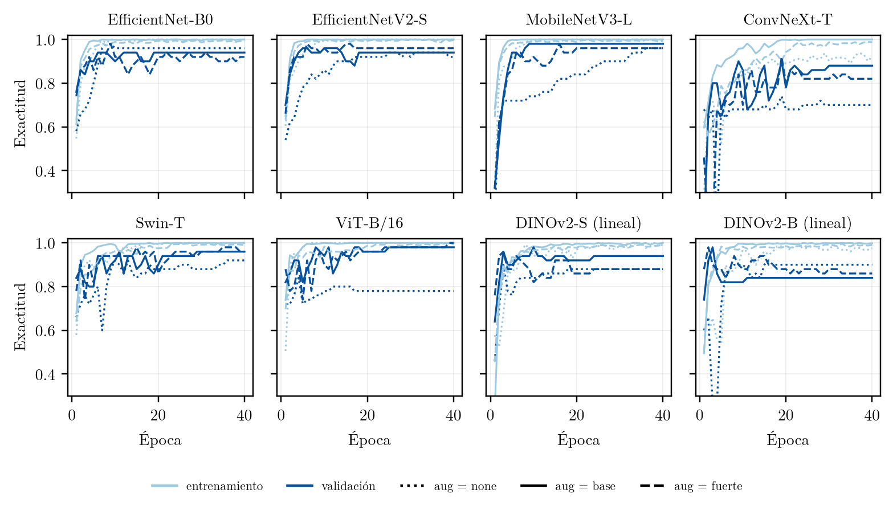
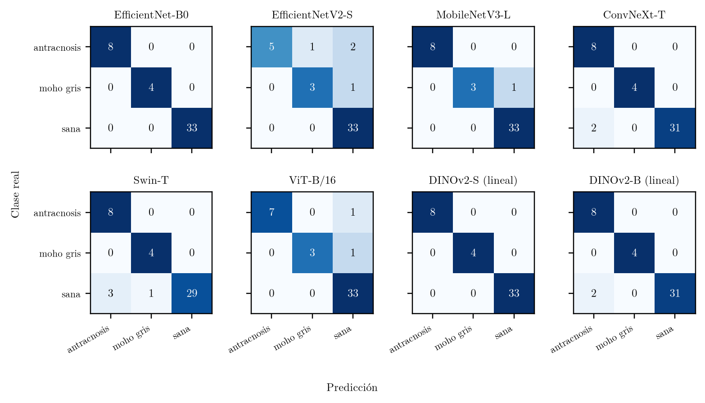
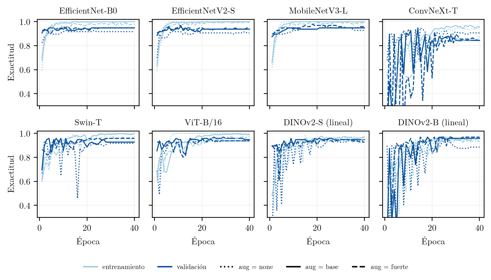
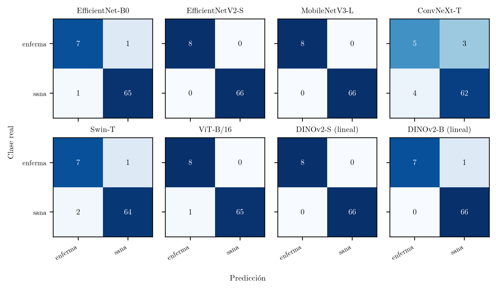
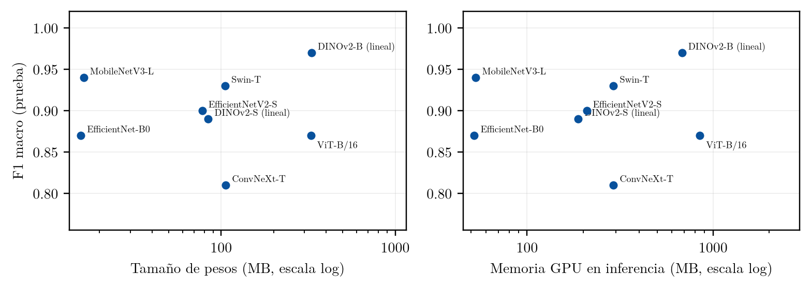

<p align="center">
  
</p>

<p align="center">
  
  
  
  
  
</p>

**MERCOIA** es un dataset de imágenes RGB de frutos de mora, piña y banano tomadas en campo con celular, y un banco de pruebas para el diagnóstico de enfermedades con redes neuronales. Las fotos se segmentan con SAM 3 en recortes de un fruto (o un racimo, en banano), los recortes se etiquetan a mano y sobre ellos se comparan ocho arquitecturas de clasificación del estado del arte con el mismo protocolo. Este repositorio contiene el código del pipeline completo (desde la descarga de las fotos hasta la inferencia), las etiquetas, los resultados de los 72 entrenamientos y los dos modelos recomendados para el prototipo móvil.

## Contenido

- [El dataset](#el-dataset)
- [Pipeline](#pipeline)
- [Estructura esperada del dataset](#estructura-esperada-del-dataset)
- [Entorno](#entorno)
- [Inicio rápido](#inicio-rápido)
- [Redes evaluadas](#redes-evaluadas)
- [Protocolo y métricas](#protocolo-y-métricas)
- [Resultados](#resultados)
- [Limitaciones](#limitaciones)
- [Estructura del repositorio](#estructura-del-repositorio)
- [Cita y autoría](#cita-y-autoría)

## El dataset

Estado al 17 de octubre de 2026. Un **recorte** es la imagen de un solo fruto sobre fondo blanco producida por SAM 3; de una foto salen uno o varios recortes. Los recortes **pendientes** ya están segmentados pero todavía no tienen etiqueta.

| Fruta | Fotos | Días de captura | Fotos sin segmentar | Recortes | Etiquetados | Pendientes |
|---|---:|---:|---:|---:|---:|---:|
| Mora | 870 | 9 | 482 | 3 881 | 1 467 | 2 414 |
| Piña | 787 | 7 | 268 | 1 159 | 494 | 665 |
| Banano | 835 | 40 | 444 | 814 | 94 | 720 |
| **Total** | **2 492** | | **1 194** | **5 854** | **2 055** | **3 799** |

Las *fotos sin segmentar* son de sesiones antiguas que todavía no se han pasado por SAM 3 (79 de las de mora son archivos dañados). El recuento completo, por sesión de captura, se genera en PDF con `recuento_pdf.py`.

Recortes etiquetados por clase:

| Mora | | Piña | | Banano | |
|---|---:|---|---:|---|---:|
| Sana | 1 381 | Sana | 433 | Sano | 90 |
| Antracnosis | 44 | Pudrición | 27 | Fusarium | 0 |
| Moho gris | 32 | Daño externo (cortes, mordidas) | 15 | Phytophthora | 0 |
| Botritis | 0 | Phytophthora | 8 | | |
| Fusarium | 0 | Fusarium | 4 | | |
| | | Corte interno (no se entrena) | 6 | | |
| Descartados (ilegibles) | 10 | Descartados | 1 | Descartados | 4 |

Las etiquetas están en [`Algorithm/codes/Dataset_codes/data/etiquetas.csv`](Algorithm/codes/Dataset_codes/data/etiquetas.csv) (columnas `objeto, fruta, clase`). El 7 de octubre de 2026 se revisaron una por una las clases de enfermedad y una muestra de las sanas, en láminas numeradas, cruzando cada etiqueta con la predicción de un modelo entrenado por validación cruzada; cambiaron 121 de 2 055 etiquetas ([`revision_cambios.csv`](Algorithm/codes/Dataset_codes/data/revision_cambios.csv)). Criterios de etiquetado acordados:

- **Mora.** Drupas secas, pardas o momificadas → antracnosis. Cubierta gris o blanquecina, polvorienta → moho gris. Moras rojas o verdes inmaduras y "drupa blanca" por sol → sana.
- **Piña.** Pudrición solo con tejido podrido visible, sin importar la madurez. Cortes, grietas y mordidas → daño externo, que es una clase aparte y no cuenta como enfermedad. Fotos de piña cortada por dentro → corte interno, que no se usa para entrenar.
- **Banano.** Se segmenta por racimo (`"bunch of bananas"`); las fotos de bananos sueltos se segmentan por dedo (`"banana"`).

**Convención de nombres.** Fotos: `<Fruta>_<Mes>_<DD>_<N>`, con la fecha real de captura tomada del archivo original del celular (por ejemplo `Banan_Jun_10_25.jpg`). Recortes: `<foto>_<NN>.png` (por ejemplo `Banan_Jun_10_25_00.png`). Solo 11 fotos descargadas de Internet o WhatsApp, sin fecha, conservan su nombre original.

**Descarga.** Las imágenes (≈ 21 GB) están en Google Drive: *enlace pendiente de publicación*.

## Pipeline


1. **Cruce con Drive** (`relacion_drive.py`): empareja cada foto local con su original de Drive por contenido (MD5 y hash perceptual con las cuatro rotaciones), porque los nombres no coinciden. Detecta fotos que faltan, duplicadas y corruptas.
2. **Incorporación** (`agregar_desde_drive.py`): copia lo que falta con el nombre y la fecha real de captura; `renombrar_fotos.py` aplica la misma convención a todo lo existente y propaga el cambio a recortes y CSV.
3. **Segmentación** (`segmentar.py` + `Deteccion_y_filtrado/`): SAM 3 con prompts de texto por fruta, eliminación de detecciones duplicadas y anidadas, y filtros de forma, tamaño mínimo (120 px), oclusión y enfoque. Lo descartado se guarda con el motivo en el nombre.
4. **Etiquetado** (`etiquetado_visual.py`): herramienta de teclado que muestra solo los recortes pendientes y guarda cada etiqueta al instante. `revisar_etiquetas.py` busca etiquetas dudosas por validación cruzada.
5. **Dataset de entrenamiento** (`construir_dataset.py`): lo reconstruye desde `etiquetas.csv` con un mapa de clases y agrega copias aumentadas solo a las clases minoritarias.
6. **Entrenamiento y evaluación** (`sota_networks/`): las ocho redes con el mismo protocolo, registro en Weights & Biases, medición de costo e informes.

## Estructura esperada del dataset

Al descargar el dataset de Drive, sus dos carpetas de imágenes van en estas rutas del repositorio (los scripts las buscan ahí):

```
mercoia/
├── Algorithm/
│   ├── Our_dataset_sin_segmen/        # fotos completas, tal como se tomaron
│   │   ├── Moras/      Mora_May_13_1.png …
│   │   ├── Pinas/      Pina_Jun_26_48.jpg …
│   │   └── bananos/    Banan_Jun_10_25.jpg …
│   ├── data_etq/                      # dataset de entrenamiento (lo genera construir_dataset.py)
│   └── codes/
│       ├── sam3.pt                    # pesos de SAM 3 (Hugging Face: facebook/sam3)
│       └── Dataset_codes/data/etiquetas.csv
└── dataset_segm/                      # recortes segmentados por SAM 3
    ├── Moras/      Mora_May_13_1_00.png …
    ├── Pinas/
    ├── Bananos/
    └── descartes/                     # recortes rechazados por los filtros, con el motivo en el nombre
```

## Entorno

```bash
conda create -n mercoia python=3.14
conda activate mercoia
pip install -r requirements.txt
```

La segmentación necesita además `sam3.pt` (3.4 GB), que Meta distribuye con licencia en `huggingface.co/facebook/sam3`; se descarga con `hf download facebook/sam3 sam3.pt --local-dir Algorithm/codes` tras aceptar la licencia. Para registrar entrenamientos en Weights & Biases, defina `WANDB_API_KEY` o ejecute `wandb login`.

## Inicio rápido

**Inferencia** con los modelos incluidos (solo necesita `torch`, `torchvision` y `Pillow`; funciona en CPU):

```bash
cd inferencia
python inferencia.py --pesos pesos/mora_efficientnet_b0.pth    --entrada mora_test
python inferencia.py --pesos pesos/pina_mobilenet_v3_large.pth --entrada pina_test
```

La entrada es una imagen o una carpeta de **recortes** (fruto sobre fondo blanco). Si la carpeta trae un `etiquetas.csv`, el script compara cada predicción con su etiqueta.

**Actualizar el dataset** con fotos nuevas de Drive:

```bash
python Algorithm/codes/Dataset_codes/relacion_drive.py         # qué falta
python Algorithm/codes/Dataset_codes/agregar_desde_drive.py    # copiar y renombrar
python Algorithm/codes/Dataset_codes/segmentar.py mora --gpu 0 # SAM 3 (mora | pina | banano)
python Algorithm/codes/Dataset_codes/etiquetado_visual.py      # etiquetar lo pendiente
python Algorithm/codes/Dataset_codes/estado_dataset.py         # recuento en Excel
python Algorithm/codes/Dataset_codes/recuento_pdf.py           # recuento en PDF (avance del proyecto)
```

**Reproducir un benchmark** (las 8 redes para una fruta y un nivel de aumento):

```bash
python Algorithm/codes/Dataset_codes/construir_dataset.py
python sota_networks/run_all.py --fruta pina --gpu 0 --data Algorithm/data_etq --balance --aug none
python sota_networks/reporte.py --fruta pina --tag _balance_data_etq --data Algorithm/data_etq
```

## Redes evaluadas

Se eligieron ocho arquitecturas que cubren las familias usadas en la literatura de diagnóstico de enfermedades en plantas: redes convolucionales ligeras pensadas para el celular, una red convolucional moderna, transformers de visión y un modelo fundacional autosupervisado. Todas parten de pesos preentrenados; en cada una se reemplaza la última capa por una capa lineal con tantas salidas como clases.

| Red | Familia | Parámetros (M) | Preentrenamiento | Ajuste |
|---|---|---:|---|---|
| EfficientNet-B0 | CNN móvil | 4.0 | ImageNet-1k | completo |
| MobileNetV3-L | CNN móvil | 4.2 | ImageNet-1k | completo |
| EfficientNetV2-S | CNN | 20.2 | ImageNet-1k | completo |
| ConvNeXt-T | CNN moderna | 27.8 | ImageNet-1k | completo |
| Swin-T | Transformer jerárquico | 27.5 | ImageNet-1k | completo |
| ViT-B/16 | Transformer | 85.8 | ImageNet-1k | completo |
| DINOv2 ViT-S/14 | Fundacional | 22.1 | LVD-142M (autosupervisado) | sonda lineal |
| DINOv2 ViT-B/14 | Fundacional | 86.6 | LVD-142M (autosupervisado) | sonda lineal |

- **EfficientNet-B0** (Tan y Le, 2019). Escala de forma conjunta la profundidad, el ancho y la resolución de una red base encontrada por búsqueda de arquitectura, con bloques MBConv (convoluciones separables en profundidad) y atención por canal *squeeze-and-excitation*. Es la red de referencia para equipos con poca memoria.
- **MobileNetV3-L** (Howard et al., 2019). Diseñada para celulares con búsqueda de arquitectura consciente de la latencia, bloques invertidos con *squeeze-and-excitation* y la activación *hard-swish*, más barata de calcular.
- **EfficientNetV2-S** (Tan y Le, 2021). Sucesora de EfficientNet que usa bloques Fused-MBConv en las primeras etapas para entrenar más rápido; más grande y precisa en ImageNet.
- **ConvNeXt-T** (Liu et al., 2022). Una ResNet "modernizada" con las decisiones de diseño de los transformers: núcleos de 7×7, normalización por capa, menos activaciones y un diseño por etapas. Muestra que una CNN pura puede competir con los transformers.
- **Swin-T** (Liu et al., 2021). Transformer jerárquico que calcula la atención dentro de ventanas locales que se desplazan entre capas, lo que le da el sesgo de localidad de una CNN con el modelado de largo alcance de un transformer.
- **ViT-B/16** (Dosovitskiy et al., 2021). Transformer puro: divide la imagen en parches de 16×16, los trata como una secuencia de palabras y aplica atención global. Sin sesgos de localidad, depende mucho del preentrenamiento.
- **DINOv2 S y B** (Oquab et al., 2024). ViT entrenados de forma autosupervisada sobre 142 millones de imágenes curadas, cuyas características se usan congeladas. Solo se entrena una capa lineal encima (*sonda lineal*), lo que mide qué tan útiles son las características genéricas para la tarea.

La implementación está en [`sota_networks/models.py`](sota_networks/models.py); cualquier modelo de `timm` se puede añadir con el prefijo `timm:`.

## Protocolo y métricas

Las ocho redes se entrenan con exactamente el mismo protocolo para que la comparación sea justa:

- **Partición** 70/15/15 estratificada por clase y **agrupada por foto**: los recortes de una misma foto nunca quedan repartidos entre entrenamiento y prueba. Semilla 42. Las copias aumentadas en disco (`aug_*`) solo entran a entrenamiento.
- **Optimización**: entropía cruzada (ponderada por frecuencia de clase con `--balance`), SGD con momento 0.9 y *weight decay* 5·10⁻⁴, tasa 0.01 reducida ×0.1 en las épocas 20 y 30, 40 épocas, lote de 64, 224×224 píxeles, precisión mixta. Las sondas de DINOv2 usan tasa 0.1 y lote de 128.
- **Selección**: se guarda el checkpoint con mejor exactitud de validación y con él se evalúa la prueba.
- **Aumento de datos**: `none` (ninguno), `base` (recorte aleatorio, volteos, rotación de ±15° y color suave, más copias `aug_*`) y `fuerte` (`base` + TrivialAugmentWide).

Métricas:

- **Exactitud** en prueba y **F1 macro**, que es la principal: promedia el F1 de cada clase sin pesar por su tamaño, de modo que una red que diga "sana" a todo queda en evidencia aunque su exactitud sea alta.
- **Intervalo de confianza** de Clopper–Pearson al 95 % para la exactitud, porque los conjuntos de prueba son pequeños.
- **Costo**: parámetros, tamaño de los pesos, tiempo de entrenamiento, tiempo de inferencia (lote 1, fp16, mediana de 200 pasadas tras 30 de calentamiento) y memoria GPU pico en inferencia, medidos en una NVIDIA RTX 4070 de 12 GB.

## Resultados

Todas las corridas están en [`resultados/resultados.csv`](resultados/resultados.csv) y el costo de cada una en `resultados/especificaciones_*.csv`. Los informes técnicos completos (en LaTeX) están en [`resultados/informes/`](resultados/informes/).

### Mora: antracnosis / moho gris / sana

Dataset `Algorithm/data`, anterior a la revisión de etiquetas. Prueba: 45 imágenes (8 antracnosis, 4 moho gris, 33 sanas). Exactitud / F1 macro:

| Red | `none` | `base` | `fuerte` |
|---|---|---|---|
| EfficientNet-B0 | 0.978 / 0.947 | **1.000 / 1.000** | **1.000 / 1.000** |
| EfficientNetV2-S | 0.956 / 0.920 | 0.911 / 0.825 | 0.978 / 0.973 |
| MobileNetV3-L | 0.956 / 0.920 | 0.978 / 0.947 | 0.978 / 0.947 |
| ConvNeXt-T | 0.978 / 0.973 | 0.956 / 0.953 | 0.889 / 0.859 |
| Swin-T | 0.933 / 0.894 | 0.911 / 0.889 | 0.956 / 0.953 |
| ViT-B/16 | 0.978 / 0.947 | 0.956 / 0.920 | 0.978 / 0.947 |
| DINOv2-S (lineal) | 0.844 / 0.683 | **1.000 / 1.000** | 0.911 / 0.873 |
| DINOv2-B (lineal) | 0.933 / 0.881 | 0.956 / 0.953 | 0.956 / 0.910 |
| **Promedio** | 0.944 / 0.896 | 0.958 / 0.936 | 0.956 / 0.933 |

<p align="center">
  <br>
  
</p>

### Piña: enferma / sana

Dataset `Algorithm/data_etq`, construido desde `etiquetas.csv` con pérdida ponderada (en ese momento "enferma" agrupaba pudrición, phytophthora, fusarium y afectación externa). Sanas y enfermas comparten la sesión de captura principal, así que el modelo no puede separarlas reconociendo la sesión. Prueba: 74 imágenes (66 sanas, 8 enfermas). Exactitud / F1 macro:

| Red | `none` | `base` | `fuerte` |
|---|---|---|---|
| EfficientNet-B0 | 0.973 / 0.930 | 0.946 / 0.874 | 0.973 / 0.930 |
| EfficientNetV2-S | **1.000 / 1.000** | 0.960 / 0.900 | 0.946 / 0.874 |
| MobileNetV3-L | **1.000 / 1.000** | 0.973 / 0.937 | 0.973 / 0.937 |
| ConvNeXt-T | 0.905 / 0.767 | 0.905 / 0.806 | 0.919 / 0.810 |
| Swin-T | 0.960 / 0.900 | 0.973 / 0.930 | 0.946 / 0.874 |
| ViT-B/16 | 0.987 / 0.967 | 0.946 / 0.874 | 0.973 / 0.930 |
| DINOv2-S (lineal) | **1.000 / 1.000** | 0.960 / 0.889 | 0.960 / 0.874 |
| DINOv2-B (lineal) | 0.987 / 0.963 | 0.987 / 0.967 | 0.973 / 0.930 |
| **Promedio** | **0.976 / 0.941** | 0.956 / 0.897 | 0.958 / 0.895 |

Una primera ronda con el dataset armado a mano (70 imágenes, prueba de 9) dio resultados no concluyentes y se documenta en `resultados/informes/informe_pina_ronda1.pdf`.

<p align="center">
  <br>
  
</p>

### Costo computacional

Con aumento `base` (lote 1, fp16, 224×224, RTX 4070):

| Red | Pesos (MB) | Memoria en inferencia (MB) | Inferencia mora (ms/img) | Entrenamiento mora (min, 40 épocas) |
|---|---:|---:|---:|---:|
| EfficientNet-B0 | 15.6 | **52** | 14.2 | 2.4 |
| MobileNetV3-L | 16.2 | 53 | 11.0 | 2.3 |
| EfficientNetV2-S | 77.8 | 209 | 30.1 | 2.8 |
| DINOv2-S (lineal) | 84.2 | 188 | 21.6 | 2.3 |
| Swin-T | 105.3 | 291 | 15.1 | 2.9 |
| ConvNeXt-T | 106.2 | 291 | 18.6–45.0 | 2.7 |
| DINOv2-B (lineal) | 330.3 | 680 | 8.4 | 2.7 |
| ViT-B/16 | 327.4 | 848 | **7.2** | 3.5 |

En una GPU con una sola imagen manda el número de lanzamientos de kernel, por eso ViT-B/16 aparece como la más rápida; en un celular mandan el tamaño y la memoria, donde EfficientNet-B0 y MobileNetV3-L son veinte veces más livianas con la misma exactitud.

<p align="center"></p>

### Modelos recomendados

| Fruta | Modelo | Archivo | Prueba interna | Prueba con 10 recortes no vistos |
|---|---|---|---|---|
| Mora | EfficientNet-B0, aumento `base` | `inferencia/pesos/mora_efficientnet_b0.pth` (16 MB) | 45/45 | 4/10 |
| Piña | MobileNetV3-L, sin aumento | `inferencia/pesos/pina_mobilenet_v3_large.pth` (17 MB) | 74/74 | 9/10 |

La prueba con recortes no vistos usa las carpetas `inferencia/mora_test` y `inferencia/pina_test`, con etiquetas revisadas.

## Limitaciones

- **Mora generaliza mal fuera de sus sesiones.** El 100 % interno de mora se obtuvo con un conjunto de prueba de las mismas sesiones de captura que el entrenamiento, en el que cada clase venía casi de una sola sesión; con recortes de otras fotos y etiquetas revisadas acierta 4 de 10. Hay que reentrenarlo con el dataset reconstruido desde `etiquetas.csv`.
- **Pocas imágenes enfermas.** Hay 44 antracnosis y 32 moho gris en mora, 39 piñas enfermas y ningún banano enfermo etiquetado. Los conjuntos de prueba tienen de 4 a 8 imágenes enfermas, así que los intervalos de confianza son anchos (74/74 → [0.951, 1.000]).
- **Una sola semilla** y sin prueba en una sesión de captura independiente.
- **Costo medido en GPU de escritorio**, no en el celular de destino.

## Estructura del repositorio

```
mercoia/
├── README.md · title.png · requirements.txt
├── assets/portada.py                    # genera title.png (pixel art)
├── Algorithm/codes/
│   ├── efficenet.py                     # transformaciones, partición por foto, utilidades de entrenamiento
│   └── Dataset_codes/
│       ├── relacion_drive.py            # cruce local ↔ Drive por contenido
│       ├── agregar_desde_drive.py       # copia y renombra las fotos que faltan
│       ├── renombrar_fotos.py           # convención Fruta_Mes_DD_N en todo el dataset
│       ├── segmentar.py                 # SAM 3 por fruta (--patron, --prompts)
│       ├── Deteccion_y_filtrado/        # prompts y filtros de SAM 3 por fruta
│       ├── etiquetado_visual.py         # herramienta de etiquetado por teclado
│       ├── revisar_etiquetas.py         # etiquetas dudosas por validación cruzada
│       ├── construir_dataset.py         # etiquetas.csv → dataset de entrenamiento
│       ├── generar_augmentacion.py      # copias aumentadas en disco
│       ├── estado_dataset.py            # recuento del dataset en Excel
│       ├── recuento_pdf.py              # recuento del dataset en PDF, por fruta, clase y sesión
│       └── data/                        # etiquetas.csv, relacion_drive.csv, revision_cambios.csv
├── sota_networks/
│   ├── models.py                        # las 8 arquitecturas
│   ├── train.py · run_all.py            # entrenamiento de una red / de las 8
│   ├── reporte.py                       # costo: tiempo, memoria, pesos
│   ├── predecir.py                      # inferencia con cualquier checkpoint del banco
│   └── informe/figuras.py               # curvas y matrices de confusión
├── inferencia/
│   ├── inferencia.py                    # script autocontenido
│   ├── pesos/                           # modelos recomendados de mora y piña
│   └── mora_test/ · pina_test/          # 10 recortes etiquetados por fruta
└── resultados/
    ├── resultados.csv · especificaciones_*.csv
    ├── figuras/                         # curvas, matrices, compromiso tamaño/F1
    └── informes/                        # informes técnicos en PDF
```

## Cita y autoría

Proyecto MERCOIA, Universidad Industrial de Santander. Autor: Jose Barrios.

```bibtex
@misc{mercoia2026,
  title  = {MERCOIA: dataset y banco de pruebas para el diagnóstico de enfermedades en mora, piña y banano a partir de imágenes RGB},
  author = {Barrios, Jose},
  year   = {2026},
  howpublished = {\url{https://github.com/Josebarr20/mercoia}}
}
```

Referencias de las arquitecturas: Tan y Le (ICML 2019, ICML 2021), Howard et al. (ICCV 2019), Liu et al. (CVPR 2022; ICCV 2021), Dosovitskiy et al. (ICLR 2021), Oquab et al. (TMLR 2024), Müller y Hutter (ICCV 2021, TrivialAugment). Segmentación con SAM 3 de Meta, vía Ultralytics.
