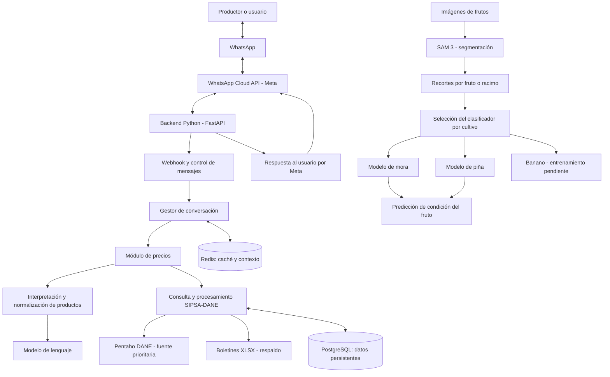
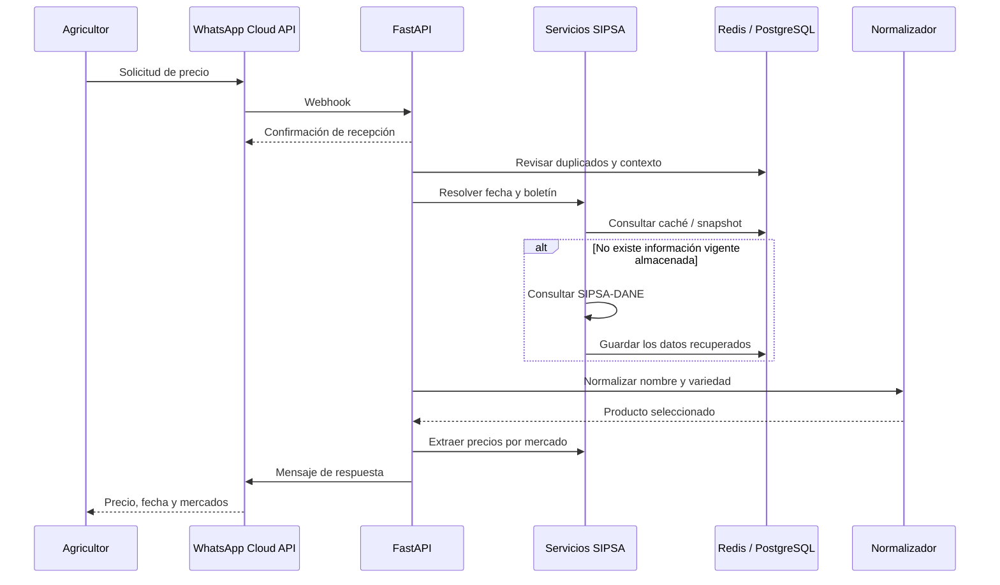
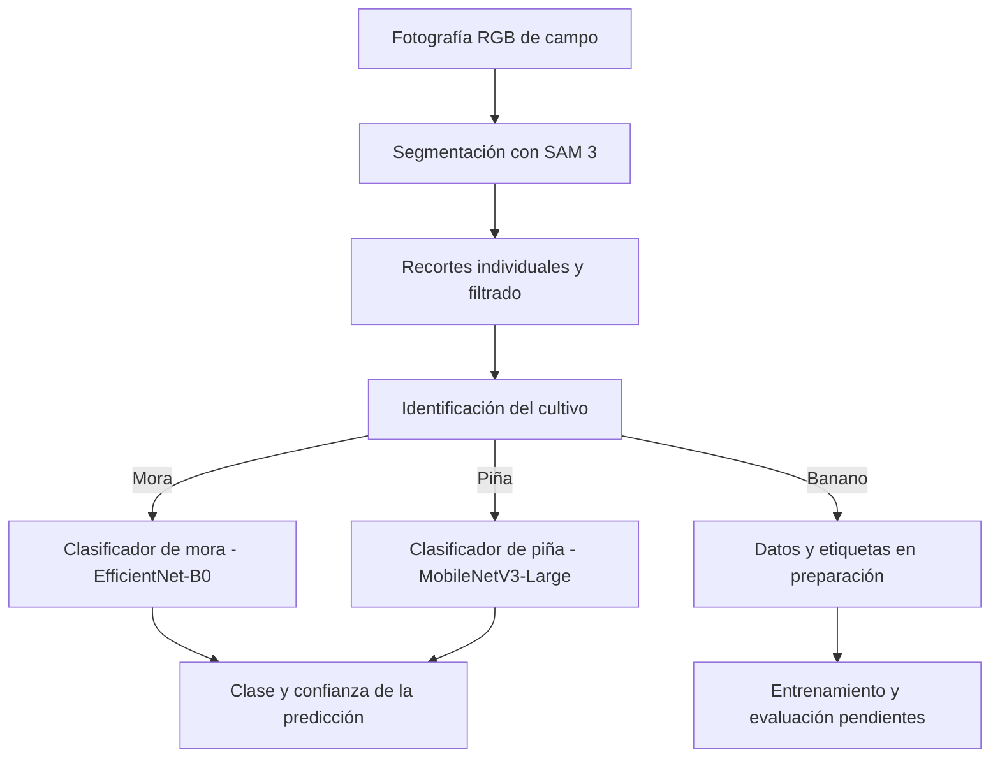

# MercoIA Platform

<p align="center">
  
</p>

## Plataforma digital inteligente para la soberanía alimentaria y el derecho a la alimentación

Este repositorio contiene la versión preliminar de desarrollo de **MercoIA**, una plataforma digital inteligente construida en el marco del proyecto:

**“Plataforma digital inteligente para la soberanía alimentaria y el derecho a la alimentación, basada en la consulta comparativa de precios en mercados mayoristas y la detección temprana de enfermedades en cultivos mediante IA, como herramienta para una producción sostenible y competitiva en asociaciones campesinas de Santander.”**

El proyecto busca apoyar a asociaciones campesinas y productores agrícolas mediante una herramienta digital que facilite el acceso a información relevante para la toma de decisiones en dos dimensiones principales:

1. **Comercialización agrícola**, mediante la consulta comparativa de precios de productos agrícolas en mercados mayoristas.
2. **Gestión fitosanitaria y productiva**, mediante el análisis de imágenes agrícolas usando modelos de inteligencia artificial para apoyar la detección de enfermedades, el análisis visual de frutos y la generación de recomendaciones.

La plataforma se desarrolla para contextos rurales, considerando la necesidad de construir soluciones accesibles, operables mediante canales digitales cotidianos y con capacidad de integrar módulos de automatización, procesamiento de datos e inteligencia artificial.

---

## Enfoque del proyecto

El enfoque de MercoIA consiste en integrar herramientas digitales y modelos de inteligencia artificial dentro de una arquitectura modular que permita a los usuarios interactuar con la plataforma de forma sencilla. En lugar de exigir que el agricultor utilice aplicaciones complejas o sistemas especializados, el diseño de la plataforma parte de canales de uso frecuente, como **WhatsApp**, y los conecta con flujos automáticos de procesamiento.

La herramienta se orienta a:

- Centralizar y procesar información de precios agrícolas.
- Facilitar consultas sobre precios de productos en mercados mayoristas.
- Organizar bases de datos de productos agrícolas.
- Procesar imágenes de frutos o cultivos.
- Apoyar tareas de detección, segmentación y análisis visual.
- Generar respuestas o recomendaciones útiles para el productor.
- Integrar módulos de inteligencia artificial con interfaces prácticas para usuarios no especializados.

---

## ¿Qué hace MercoIA?

MercoIA funciona como una plataforma digital compuesta por dos módulos principales:

### 1. Módulo de consulta de precios agrícolas

Este módulo permite consultar información de precios mayoristas de productos agrícolas. El sistema procesa información proveniente de fuentes de precios, organiza los datos, normaliza nombres de productos y permite generar respuestas automáticas al usuario.

### 2. Módulo de detección de enfermedades y análisis de frutos

Este módulo procesa imágenes agrícolas para apoyar tareas de segmentación, detección, análisis visual y estimación de condiciones relacionadas con enfermedades o maduración de frutos. El módulo se encuentra en etapa preliminar de desarrollo y validación.

Ambos módulos se integran dentro de una misma plataforma, permitiendo que la herramienta pueda crecer progresivamente hacia un sistema completo de apoyo a la toma de decisiones agrícolas.

---

## Arquitectura general de la plataforma

MercoIA articula **dos componentes tecnológicos especializados**: la consulta conversacional de precios agrícolas y el análisis de imágenes para identificar condiciones fitosanitarias de frutos. Ambos comparten el propósito de apoyar decisiones del productor, pero **no deben confundirse sus estados de despliegue**: el servicio de precios cuenta con una implementación de backend y mensajería; el componente de imágenes dispone de un pipeline de segmentación, entrenamiento y clasificación que todavía requiere completar su integración con el canal de atención al agricultor.

La arquitectura vigente del **módulo de precios** sustituye los flujos de automatización de la versión anterior por un backend propio en **Python/FastAPI** y utiliza **WhatsApp Cloud API de Meta**, en lugar de servicios de mensajería no oficiales. Los procesos de aplicación, consulta de datos y almacenamiento se mantienen separados para facilitar mantenimiento, pruebas y escalamiento.



> **Estado de integración:** el diagrama representa los componentes técnicos documentados, **no un servicio único en producción completamente integrado**. El backend de precios implementa actualmente el menú conversacional; la ruta del módulo de enfermedades se mantiene como opción pendiente de integración en ese backend. No se dispone todavía de un reporte estadístico consolidado de usuarios ni de una prueba final de operación simultánea a gran escala.

### Tecnologías empleadas

| Componente | Tecnología | Función documentada |
|---|---|---|
| Interacción | WhatsApp y WhatsApp Cloud API (Meta) | Recepción de consultas y envío de respuestas del módulo de precios. |
| Aplicación | Python y FastAPI | Webhooks, lógica de conversación y servicios de consulta. |
| Persistencia | PostgreSQL y SQLAlchemy | Almacenamiento de boletines procesados y registros de conversación. |
| Caché y contexto | Redis | Reutilización temporal de datos, desambiguaciones, menús y deduplicación. |
| Fuente de precios | SIPSA-DANE: Pentaho y XLSX | Recuperación de precios mayoristas y procesamiento por fecha. |
| Interpretación del lenguaje | Modelo de lenguaje y rutinas de normalización | Asociación de la solicitud con productos disponibles en SIPSA. |
| Despliegue del backend | Docker y Docker Compose | Servicios de aplicación, PostgreSQL y Redis. |
| Segmentación de imágenes | SAM 3 | Obtención de regiones individuales de frutos o racimos. |
| Modelos de visión | PyTorch, Torchvision y modelos de clasificación | Clasificación por cultivo de imágenes previamente segmentadas. |

---

## Organización del repositorio y versiones de desarrollo

El repositorio principal **`MercoIA_Platform`** reúne la documentación y los soportes del proyecto. **Importante:** a la fecha de esta actualización, algunas rutas publicadas en este repositorio todavía corresponden a la implementación anterior. Los dos paquetes de código revisados para actualizar esta documentación contienen implementaciones más recientes que **aún deben sincronizarse con este repositorio principal**. Por esta razón se distingue explícitamente entre **archivos publicados** e **implementaciones actualizadas aportadas por el equipo**.

### Estructura actualmente publicada en `MercoIA_Platform`

```text
MercoIA_Platform/
├── README.md
├── assets/
│   ├── logo_mercoia.png
│   ├── arquitectura_general_mercoia.png       # esquema anterior: no usar como arquitectura vigente
│   ├── organizacion_informacion.png
│   ├── pipeline_modulo_precios.png            # figura de versión anterior
│   └── pipelineenfermedades.png
├── Modulo_precios/
│   ├── docs/                                 # documentación previa
│   ├── src/                                  # scripts previos en JavaScript
│   └── workflows/                            # material histórico, NO operativo
└── Modulo_Deteccion_enfermedades/
    ├── STSIVA/
    ├── codes_for_the_dataset/
    ├── images/
    └── network/
```

Los diagramas de arquitectura anteriores se mantienen únicamente como **antecedentes de desarrollo**. El esquema Mermaid incluido arriba describe el diseño actualizado; se evita reutilizar imágenes que todavía representan conexiones obsoletas.

### Organización de los paquetes técnicos actualizados

Los paquetes de desarrollo más recientes, que deberán incorporarse o enlazarse desde el repositorio principal, se encuentran organizados de la siguiente manera:

```text
Módulo de precios (paquete FastAPI)
├── app/
│   ├── main.py
│   ├── config.py
│   ├── db.py
│   ├── models.py
│   ├── routers/
│   │   ├── webhook.py
│   │   └── health.py
│   └── services/
│       ├── conversation.py
│       ├── classifier.py
│       ├── ambiguous.py
│       ├── normalizer.py
│       ├── pricing.py
│       ├── sipsa_dates.py
│       ├── sipsa_fetch.py
│       ├── sipsa_pentaho.py
│       ├── sipsa_parser.py
│       ├── whatsapp_client.py
│       └── otros servicios auxiliares
├── scripts/
├── tests/
├── Dockerfile
├── docker-compose.yml
├── requirements.txt
└── .env.example

Módulo de enfermedades (paquete de visión)
├── Algorithm/codes/
│   ├── Dataset_codes/
│   │   ├── segmentar.py
│   │   ├── etiquetado_visual.py
│   │   ├── construir_dataset.py
│   │   ├── generar_augmentacion.py
│   │   └── data/                               # etiquetas y metadatos CSV
│   └── efficenet.py
├── sota_networks/
│   ├── models.py
│   ├── train.py
│   ├── run_all.py
│   ├── reporte.py
│   └── predecir.py
├── inferencia/
│   ├── inferencia.py
│   ├── pesos/
│   ├── mora_test/
│   └── pina_test/
├── resultados/
│   ├── resultados.csv
│   ├── especificaciones_*.csv
│   ├── figuras/
│   └── informes/
└── requirements.txt
```

> Las dos estructuras anteriores describen **los paquetes de código facilitados para esta actualización**, no rutas ya publicadas dentro de `MercoIA_Platform`. No ejecutar comandos desde la raíz del repositorio principal suponiendo que esas carpetas nuevas ya existen: deben descargarse los paquetes correspondientes o realizarse primero su incorporación.

---

# Módulo de consulta de precios agrícolas

## Implementación actual

El módulo de precios es un asistente conversacional que permite consultar valores de referencia publicados por el **Sistema de Información de Precios y Abastecimiento del Sector Agropecuario (SIPSA)** del DANE. Su implementación actual utiliza **Python, FastAPI y la API oficial de WhatsApp de Meta**. La lógica de recepción, interpretación, consulta, persistencia y respuesta se encuentra organizada en servicios, sin depender de un constructor visual de flujos.

El procesamiento comprende recepción de mensajes, selección de opciones del menú, detección de fechas, identificación del producto solicitado, resolución de variedades ambiguas, búsqueda de cotizaciones, construcción de una respuesta legible y envío al usuario. La normalización de productos combina reglas de texto, opciones disponibles del boletín consultado y el modelo de lenguaje configurado.

### Flujo de consulta



### Fuente de datos: SIPSA-DANE

La implementación revisada consulta prioritariamente el **servicio Pentaho asociado al SIPSA-DANE** y utiliza los **anexos diarios XLSX** como alternativa cuando no se obtiene la información requerida de la fuente prioritaria. El orden puede configurarse en la aplicación. Ambas fuentes se procesan para generar registros comparables.

La configuración del código contempla, entre otras, las siguientes plazas mayoristas:

- **Centroabastos**, Bucaramanga, Santander.
- **Corabastos**, Bogotá D. C.

Las plazas, fechas y productos disponibles dependen de lo publicado por SIPSA. Una consulta de un producto no incluido en la fuente no equivale a un registro de precio cero; debe notificarse la falta de información y evitarse la sustitución silenciosa por una variedad diferente.

El procesamiento incluye fechas relativas (por ejemplo, «hoy», «ayer» o «hace dos días»), normalización ortográfica, desambiguación de variedades y respuestas con fecha, mercado y precio por kilogramo. Cuando la fuente ofrece datos suficientes, pueden calcularse variaciones respecto a la observación previa; deben interpretarse como información derivada de los registros disponibles, no como predicciones.

### Organización y persistencia de información

**PostgreSQL** conserva información procesada y registros operativos de la conversación. **Redis** permite recuperar datos recientes, guardar contexto temporal, reducir consultas repetidas y evitar procesamiento duplicado de eventos reenviados por el proveedor. Esta organización facilita que una consulta repetida no implique necesariamente una nueva descarga del mismo boletín.

En los servicios de consulta se incluyen mecanismos de uso de caché, respaldo entre fuentes y refresco periódico. También se prevé un circuito de protección frente a fallos temporales del servicio Pentaho. Dichas medidas contribuyen a la continuidad del servicio, pero **no constituyen por sí solas una prueba de disponibilidad garantizada**.

### Backend de mensajería y continuidad operativa

El servicio expone un webhook para **WhatsApp Cloud API de Meta**, valida las solicitudes conforme a su configuración y procesa la conversación mediante tareas en segundo plano. El cliente de mensajería remite las respuestas a través de la API oficial. El proyecto incorpora además un contenedor de aplicación y contenedores de PostgreSQL y Redis.

Este diseño mejora el control del código y facilita su mantenimiento por el equipo de desarrollo. Para asegurar operación sostenida después del convenio siguen siendo necesarios un servidor accesible por HTTPS, gestión de credenciales, respaldo de datos, supervisión y financiación de la infraestructura y la mensajería. **No se presenta como comprobada una disponibilidad ininterrumpida ni capacidad de concurrencia a gran escala**.

## Pruebas y ejecución del módulo de precios

El paquete de precios incluye pruebas automatizadas para clasificación de mensajes, fechas, selección de productos, desambiguación, búsqueda de datos, manejo de respuestas y otros servicios. Estas pruebas de componentes son distintas de una validación de campo o de una certificación operativa.

Desde **la carpeta raíz del paquete FastAPI actualizado** (no desde la raíz del GitHub principal mientras no se sincronicen los archivos):

```bash
cp .env.example .env
# Completar únicamente en el entorno privado los valores de configuración.
docker compose up -d --build
curl http://localhost:8000/health
```

La configuración privada requiere los identificadores y credenciales de Meta, el token de verificación del webhook, la clave del servicio de lenguaje si corresponde y los parámetros de infraestructura. Antes de habilitar el acceso externo deben configurarse HTTPS y la verificación de firma. Las pruebas locales pueden ejecutarse con las dependencias del paquete instalado:

```bash
python -m pytest tests/
```

**Seguridad:** no publicar archivos `.env` con valores reales, tokens, claves API, credenciales, conversaciones privadas ni bases de datos con información identificable de agricultores.

---

# Módulo de detección de enfermedades y análisis de frutos

## Arquitectura especializada por cultivo

El módulo de visión **no utiliza un único clasificador para todos los frutos**. El proceso se reorganizó para separar la segmentación de la clasificación y entrenar modelos especializados por cultivo, porque la apariencia, las clases diagnósticas y la disponibilidad de ejemplos no son equivalentes entre mora, piña y banano.

La separación permite construir categorías y conjuntos de entrenamiento específicos, revisar etiquetas por cultivo y evaluar la generalización de cada clasificador. **SAM 3** se utiliza en la preparación de imágenes para localizar y segmentar los frutos o racimos; después se clasifican los recortes por medio del modelo correspondiente.



### Preparación de imágenes

El paquete técnico contiene utilidades para recuperar imágenes y relacionarlas con sus archivos originales, renombrar fotografías, realizar segmentación con SAM 3, filtrar recortes, etiquetar clases y construir conjuntos de entrenamiento. Se contemplan regiones correspondientes a frutos individuales y, en el caso de banano, segmentación por racimo o fruto según la toma.

La información etiquetada se administra mediante archivos CSV y estructuras de carpetas, que posteriormente alimentan los procesos de entrenamiento. Las imágenes de campo y los recortes no deben confundirse: **una fotografía puede generar varios recortes**, y no todos los recortes segmentados disponen necesariamente de etiqueta revisada.

### Estado documental del conjunto de imágenes

El README del paquete de visión suministrado registra el siguiente estado **al 17 de octubre de 2026**:

| Cultivo | Fotografías | Recortes segmentados | Recortes etiquetados | Pendientes de etiquetado |
|---|---:|---:|---:|---:|
| Mora | 870 | 3.881 | 1.467 | 2.414 |
| Piña | 787 | 1.159 | 494 | 665 |
| Banano | 835 | 814 | 94 | 720 |
| **Total** | **2.492** | **5.854** | **2.055** | **3.799** |

Estos valores describen el estado documentado del procesamiento de imágenes; **no representan usuarios atendidos ni diagnósticos clínicos o fitosanitarios confirmados en campo**.

## Entrenamiento y comparación de clasificadores

El banco de experimentos permite comparar **ocho arquitecturas**: EfficientNet-B0, EfficientNetV2-S, MobileNetV3-Large, ConvNeXt-Tiny, Swin-T, ViT-B/16, DINOv2 ViT-S/14 y DINOv2 ViT-B/14. El protocolo registrado utiliza partición estratificada de entrenamiento, validación y prueba, separación por grupos de imágenes del mismo fruto, aumentos de datos y evaluación por exactitud y F1 macro. Los resultados detallados se encuentran en los archivos CSV e informes del paquete de visión.

### Modelos incluidos y limitaciones de generalización

| Cultivo | Clasificador seleccionado para las pruebas | Soporte del paquete técnico | Estado de las pruebas documentadas |
|---|---|---|---|
| **Mora** | EfficientNet-B0 | `inferencia/pesos/mora_efficientnet_b0.pth` | 45/45 en prueba interna; **4/10** con recortes adicionales no vistos. Requiere revisión y reentrenamiento. |
| **Piña** | MobileNetV3-Large | `inferencia/pesos/pina_mobilenet_v3_large.pth` | 74/74 en prueba interna; **9/10** con recortes adicionales no vistos. Debe ampliarse la validación externa. |
| **Banano** | Sin clasificador final documentado | Imágenes, segmentación y etiquetas en preparación | Entrenamiento y evaluación pendientes. |

Las métricas internas no se deben interpretar como desempeño garantizado en parcelas, centros de acopio o nuevas condiciones de iluminación. La diferencia observada con fotografías adicionales, especialmente para mora, es una razón técnica para continuar la depuración de etiquetas, el reentrenamiento y las pruebas externas.

### Inferencia con los modelos incluidos

Desde la **carpeta raíz del paquete de visión actualizado**, tras instalar sus dependencias:

```bash
python inferencia/inferencia.py \
  --pesos inferencia/pesos/mora_efficientnet_b0.pth \
  --entrada inferencia/mora_test

python inferencia/inferencia.py \
  --pesos inferencia/pesos/pina_mobilenet_v3_large.pth \
  --entrada inferencia/pina_test
```

La entrada esperada por estos scripts son **recortes de fruto**, no imágenes de campo sin segmentar. El script permite consultar una imagen o un conjunto de imágenes y comparar predicciones frente a etiquetas cuando estas están disponibles.

## Relación con análisis de maduración

Además de la clasificación fitosanitaria, el proyecto ha desarrollado actividades de análisis visual de frutos y maduración, incluidas experiencias de segmentación y estimación de estados para apoyo a recomendaciones de cosecha. Estas actividades son complementarias al banco de clasificadores de enfermedades y **no deben presentarse como una funcionalidad ya integrada y validada en el mismo canal de WhatsApp**.

---

## Integración entre módulos y alcance funcional

Los componentes persiguen una experiencia unificada para el agricultor: consultar precios de referencia y acceder a análisis visuales de productos agrícolas. En el estado de desarrollo revisado se distingue entre:

| Capacidad | Estado documentado |
|---|---|
| Recepción y respuesta conversacional de consultas de precios por la API de Meta | Implementación de software disponible en el paquete del backend; requiere infraestructura y credenciales válidas para su operación externa. |
| Consulta de información SIPSA-DANE y organización en Redis/PostgreSQL | Servicios implementados y acompañados de pruebas de software. |
| Procesamiento de imágenes con SAM 3 | Herramientas de preparación y segmentación incluidas en el paquete de visión. |
| Inferencia especializada para mora y piña | Pesos y scripts de prueba disponibles; desempeño en imágenes nuevas todavía en revisión. |
| Clasificador de banano | Pendiente de entrenamiento y validación. |
| Atención integral de ambos módulos desde un único chatbot | **Integración funcional completa pendiente** en el backend revisado. |
| Pruebas piloto con beneficiarios y reporte estadístico consolidado de uso | **Pendientes de documentación y validación**. |

La distinción es relevante para el despliegue gradual de MercoIA: disponer del código fuente y de modelos de IA es un avance tecnológico importante, pero no equivale por sí mismo a una validación completa con la población beneficiaria.

---

## Estado de desarrollo, validación y próximos pasos

Los componentes revisados muestran un avance sustancial respecto a la arquitectura inicial: servicio de precios con backend propio, fuente SIPSA con respaldo, persistencia y pruebas automatizadas; pipeline de datos agrícolas con segmentación SAM 3; evaluación comparativa de redes; e inferencia especializada para mora y piña.

Se mantienen actividades necesarias para completar el producto de plataforma desplegada y optimizada:

1. **Sincronizar el repositorio principal** con el backend FastAPI y el paquete actualizado de visión, conservando historial y autorías.
2. **Completar la integración de la opción de enfermedades** en la experiencia de usuario prevista.
3. **Reentrenar y verificar el clasificador de mora** sobre etiquetas revisadas y ampliar las muestras externas de todos los cultivos.
4. **Preparar y evaluar el modelo de banano**, conforme se disponga de datos etiquetados representativos.
5. **Realizar pruebas con comunidades vinculadas a MERCORED**, incluidos escenarios rurales y puntos de acopio.
6. **Medir estabilidad, concurrencia y uso real**, documentando los resultados sin sustituirlos por proyecciones.
7. **Definir condiciones de sostenibilidad operativa**: dominio, alojamiento, seguridad, respaldo, monitoreo y presupuesto de servicios externos.

---

## Consideraciones de seguridad y publicación

Al consolidar los repositorios deben protegerse las credenciales y los datos de usuarios. Antes de publicar código o archivos de prueba, revisar especialmente:

- Variables privadas y tokens de WhatsApp Cloud API, Meta y servicios de inteligencia artificial.
- Accesos a PostgreSQL, Redis, servidores, túneles y paneles de configuración.
- Datos personales, números telefónicos, historiales de conversación o fotografías sensibles de beneficiarios.
- Licencias y condiciones de uso de modelos preentrenados, pesos y conjuntos de datos.
- Archivos binarios de gran tamaño y datasets que deban almacenarse fuera de GitHub o gestionarse mediante mecanismos adecuados.

Los archivos `.env.example` deben contener únicamente nombres de variables y valores ficticios. Las credenciales reales nunca deben incluirse en `README.md` ni en los commits.

---

## Relación con los productos del proyecto

Este repositorio constituye un soporte de documentación y trazabilidad del **P13 — Plataforma digital desplegada y optimizada**, dentro del proyecto MercoIA. Aporta información vinculada también con:

- **P9:** base de datos y procesamiento de precios agrícolas.
- **P10:** base de datos de imágenes agrícolas para detección de enfermedades.
- **P11:** modelos de inteligencia artificial para detección y clasificación de enfermedades.
- **P12:** herramienta automatizada de consulta de precios.
- **P13:** integración, optimización y despliegue gradual de la plataforma.

La documentación del repositorio **no sustituye** los informes, pruebas de aceptación, soportes de uso o verificaciones que correspondan a cada producto.

---

## Entidades participantes

**Entidad ejecutora:** Federación Agroalimentaria y Agroambiental Campesina – MERCORED  
**Entidad aliada:** Universidad Industrial de Santander – UIS  
**Grupo aliado:** HDSP  
**Convenio especial de cooperación:** 112721-268-2025  
**Convocatoria:** SENAINNOVA 2024

---

## Contacto

**HDSP – Universidad Industrial de Santander**  
Correo: **hdsp@uis.edu.co**

**Federación Agroalimentaria y Agroambiental Campesina – MERCORED**  
Correo: **federacionmercored@gmail.com**

---

## Nota de actualización

**Actualización documental: octubre de 2026.** La arquitectura descrita corresponde a los paquetes de software más recientes aportados por los equipos de desarrollo para el módulo de precios y el módulo de enfermedades. Cuando se incorporen al repositorio principal, deberá actualizarse el árbol de directorios y reemplazarse cualquier figura anterior que todavía represente la arquitectura sustituida. Los resultados experimentales y cifras del conjunto de datos tienen el corte señalado en sus apartados.
